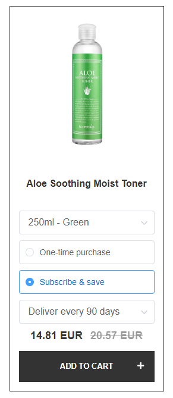
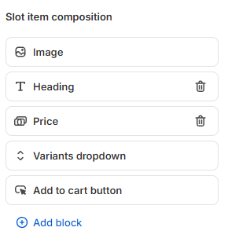
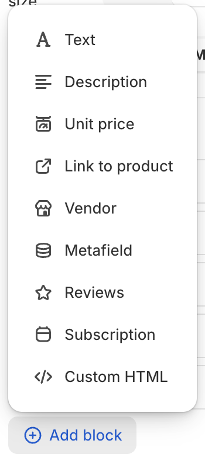
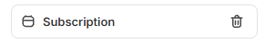
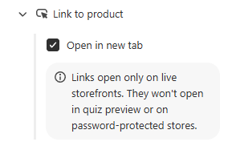

# How to Recommend Subscription Products

This article explains how to recommend subscription products, so a customer can subscribe straight from the results page.

## Set up subscriptions

=== "Shopify"

    The `Subscription` component reads the subscription plans straight from Shopify. It works with any subscription app that adds its plans to your Shopify products, such as Shopify Subscriptions, Recharge and Seal. There is nothing to connect and no subscription app to choose in the quiz.

    !!! info "What the customer sees"

        - Each variant shows its own subscription plans and its own subscription price.
        - A product card that lets the customer choose a variant can also show subscription plans.

    1. **Go to the [Results page](/reference/quiz-builder/results-page/) tab and open the settings of your [Product block](/reference/quiz-builder/results-page/#product-product-variants-collections).**

    2. **Add the `Subscription` option to `Product components layout`.**

        

        

        The component has no settings to configure.

        

        !!! info "The Quiz builder shows sample plans"

            The Quiz builder shows two sample plans in the `Subscription` component, not your real plans. The quiz preview shows a note instead of plans.

    3. **Click the top-right `Save` button.**

    4. **[Publish the quiz on a new page](/how-to-guides/publish-quiz-inline/#embed-an-inline-quiz-on-a-dedicated-landing-page) and take it through to the results page.**

        !!! warning "Your real plans appear only on your storefront"

            Test on a published quiz on a page of your website. The Quiz builder and the quiz preview cannot show your real subscription plans.

    5. **Add a subscription product to the cart, then check that the cart holds the plan you chose.**

    !!! note "Quizzes created before November 2026"

        If a quiz never had a subscription app selected in the old `Subscription app` setting, its `Subscription` component stays hidden. [Contact support](/how-to-guides/contact-customer-support/) to show it.

=== "Shopify (Legacy)"

    The app works with [Recharge Subscriptions](https://apps.shopify.com/subscription-payments?surface_intra_position=1&surface_type=partners&surface_version=redesign).

    !!! warning "Before you start"

        - Recharge exposes the Storefront API on the [Recharge Plus plan](https://getrecharge.com/pricing/) only. On any other plan, contact [Recharge support](https://support.getrecharge.com/hc/en-us#).
        - Set Recharge up on your Shopify store first, as the [Recharge documentation](https://storefront.rechargepayments.com/client/docs/getting_started/script_setup/) describes.

    1. **Go to the [Connect](/reference/quiz-builder/connect-integrations/) tab in your quiz dashboard.**

    2. **Scroll to the Recharge section and click `connect`.**

    3. **Run a [catalog sync](/how-to-guides/sync-catalog/) from the [success checklist](/reference/dashboard/#success-checklist) on your dashboard.** The sync takes 30 to 60 minutes.

    4. **Link your Recharge subscription products to the matching choices in the [Link Products](/reference/quiz-builder/link-products/) tab.**

    5. **Click `Publish`.** This updates both the preview and the live quiz.

    !!! warning "What this setup cannot do"

        - One button cannot add every product to the cart. Each subscription has to be chosen and added on its own.
        - The customer picks the subscription duration on the results page. You cannot recommend a specific duration.
        - The customer has to go to the cart first, rather than straight to checkout. You can change that in the [checkout settings](/how-to-guides/change-checkout-settings/).
        - Only the **new Shopify Checkout** works. The old Recharge Checkout does not. To move over, see the [Recharge migration guide](https://support.rechargepayments.com/hc/en-us/articles/4403505928599).

=== "WooCommerce"

    The app works with [WooCommerce Subscriptions](https://woocommerce.com/products/woocommerce-subscriptions/).

    Products created with that plugin sync to the app on their own once it is installed. They appear under the [Link Products](/reference/quiz-builder/link-products/) tab in the [Quiz Builder](/reference/quiz-builder/).

    !!! tip "If a subscription product is missing from the list"

        Run a [catalog sync](/how-to-guides/sync-catalog/).

=== "Magento"

    !!! note "Not available on this platform"

        This version cannot recommend subscription products directly. See [Other subscriptions](#other-subscriptions) for a workaround that sends the customer to the product page to subscribe.

=== "BigCommerce"

    !!! note "Not available on this platform"

        This version cannot recommend subscription products directly. See [Other subscriptions](#other-subscriptions) for a workaround that sends the customer to the product page to subscribe.

=== "Standalone"

    !!! note "Not available on this platform"

        This version cannot recommend subscription products directly. See [Other subscriptions](#other-subscriptions) for a workaround that sends the customer to the product page to subscribe.

## Other subscriptions

If the quiz cannot add your subscriptions to the cart, you can still recommend them. Send the customer to the product page instead of adding the product to the cart. They subscribe on the product page, in whatever app you use.

=== "Shopify"

    !!! tip "Most stores do not need this workaround"

        Use it only if your subscription app does not add its plans to your Shopify products. Otherwise, add the `Subscription` component as [Set up subscriptions](#set-up-subscriptions) describes.

    
<iframe src="https://www.youtube.com/embed/AWrsUZ-u2nk?si=INZh4rcHzVQ4268P" frameborder="0" webkitallowfullscreen mozallowfullscreen allowfullscreen style="position: absolute; top: 0; left: 0; width: 100%; height: 100%;"></iframe>

    1. **Pick the subscription products you want the quiz to promote.**

    2. **Create a one-time payment product for each one.** These stand in for the subscriptions inside the quiz.

    3. **Link each one-time product to the matching choices in [Link Products](/reference/quiz-builder/link-products/).** You can also pin them with [Fixed Recommendations](/how-to-guides/set-up-fixed-recommendations-quiz/#always-the-same-recommendations).

    4. **Go to the [Results page](/reference/quiz-builder/results-page/) and select a [Product block](/reference/quiz-builder/results-page/#product-product-variants-collections).**

    5. **Open [`Product Components Layout`](/reference/quiz-builder/results-page/#slot-item-composition) in the block settings.**

    6. **Remove the `Add to cart` component, then add a `Link to Product` component in its place.**

        

        

        

    !!! info "What the customer sees"

        The results page no longer adds a product to the cart. It sends the customer to the product page, where they subscribe.

=== "Shopify (Legacy)"

    1. **Pick the subscription products you want the quiz to promote.**

    2. **Create a one-time payment product for each one.** These stand in for the subscriptions inside the quiz.

    3. **Link each one-time product to the matching choices in [Link Products](/reference/quiz-builder/link-products/).**

    4. **Go to the [Results Page settings](/reference/quiz-builder/results-page/).**

    5. **Change `Add to cart` to `Link to product` in the [Checkout Settings](/how-to-guides/change-checkout-settings/).**

    !!! info "What the customer sees"

        The results page no longer adds a product to the cart. It sends the customer to the product page, where they subscribe.

=== "WooCommerce"

    1. **Pick the subscription products you want the quiz to promote.**

    2. **Create a one-time payment product for each one.** These stand in for the subscriptions inside the quiz.

    3. **Link each one-time product to the matching choices in [Link Products](/reference/quiz-builder/link-products/).**

    4. **Go to the [Results Page settings](/reference/quiz-builder/results-page/).**

    5. **Change `Add to cart` to `Link to product` in the [Checkout Settings](/how-to-guides/change-checkout-settings/).**

    !!! info "What the customer sees"

        The results page no longer adds a product to the cart. It sends the customer to the product page, where they subscribe.

=== "Magento"

    1. **Pick the subscription products you want the quiz to promote.**

    2. **Create a one-time payment product for each one.** These stand in for the subscriptions inside the quiz.

    3. **Link each one-time product to the matching choices in [Link Products](/reference/quiz-builder/link-products/).**

    4. **Go to the [Results Page settings](/reference/quiz-builder/results-page/).**

    5. **Change `Add to cart` to `Link to product` in the [Checkout Settings](/how-to-guides/change-checkout-settings/).**

    !!! info "What the customer sees"

        The results page no longer adds a product to the cart. It sends the customer to the product page, where they subscribe.

=== "BigCommerce"

    1. **Pick the subscription products you want the quiz to promote.**

    2. **Create a one-time payment product for each one.** These stand in for the subscriptions inside the quiz.

    3. **Link each one-time product to the matching choices in [Link Products](/reference/quiz-builder/link-products/).**

    4. **Go to the [Results Page settings](/reference/quiz-builder/results-page/).**

    5. **Change `Add to cart` to `Link to product` in the [Checkout Settings](/how-to-guides/change-checkout-settings/).**

    !!! info "What the customer sees"

        The results page no longer adds a product to the cart. It sends the customer to the product page, where they subscribe.

=== "Standalone"

    1. **Pick the subscription products you want the quiz to promote.**

    2. **Create a one-time payment product for each one.** These stand in for the subscriptions inside the quiz.

    3. **Link each one-time product to the matching choices in [Link Products](/reference/quiz-builder/link-products/).**

    4. **Go to the [Results Page settings](/reference/quiz-builder/results-page/).**

    5. **Change `Add to cart` to `Link to product` in the [Checkout Settings](/how-to-guides/change-checkout-settings/).**

    !!! info "What the customer sees"

        The results page no longer adds a product to the cart. It sends the customer to the product page, where they subscribe.

---

This article explains how to recommend subscription products, and what to do when your subscription app is not supported directly.