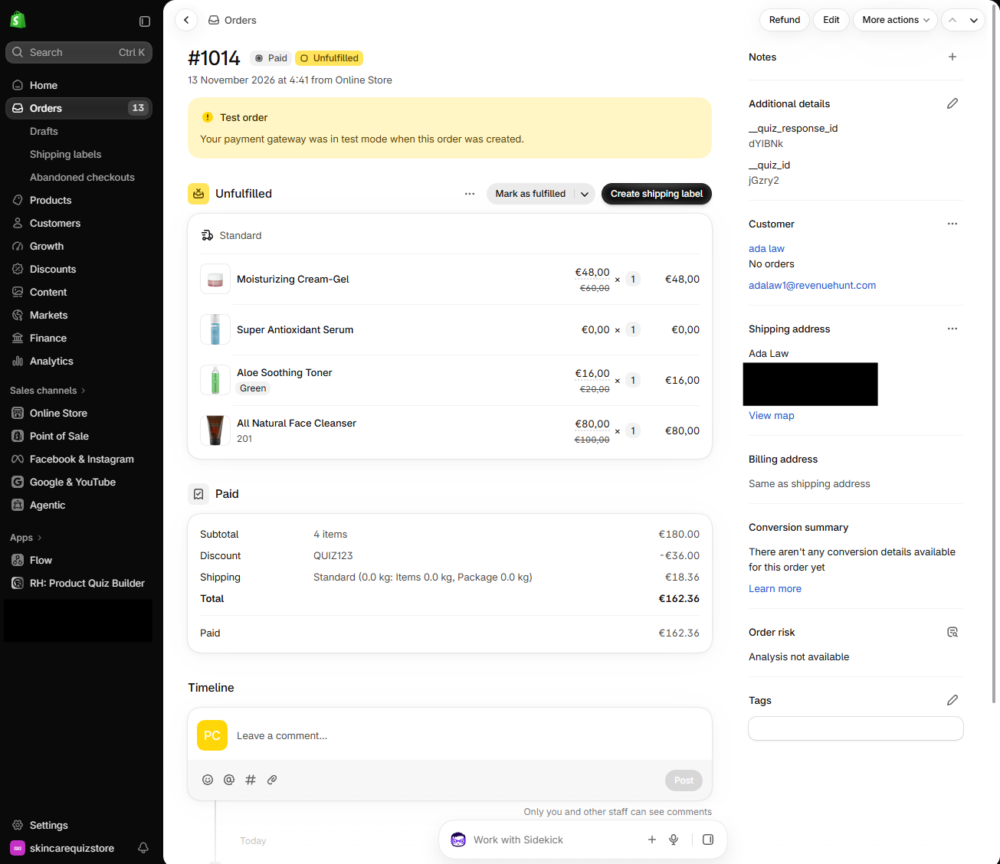
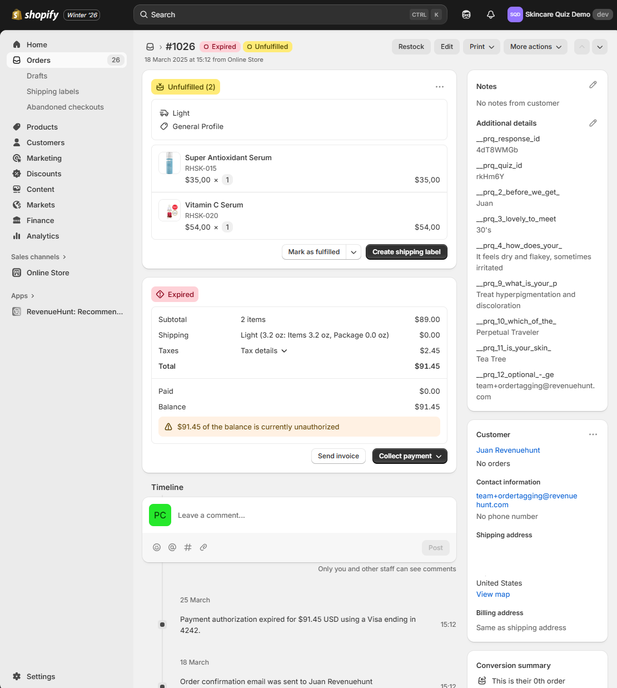
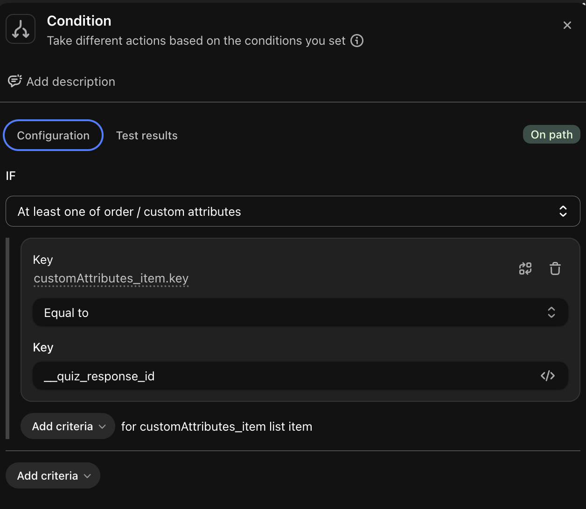
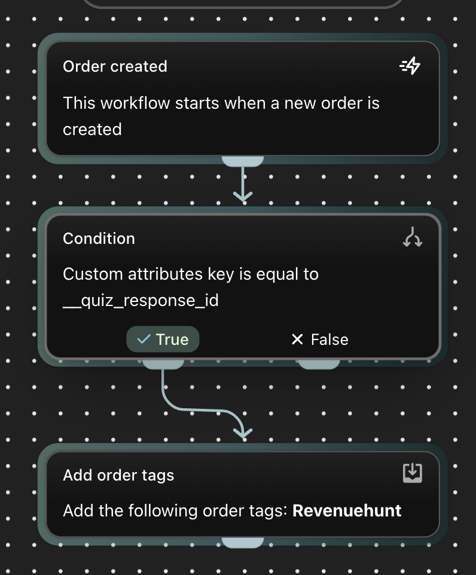
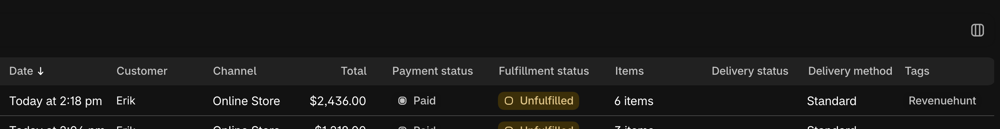
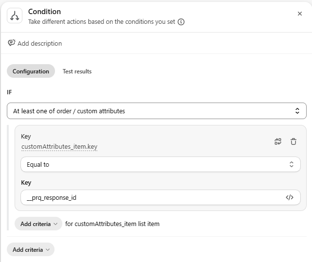
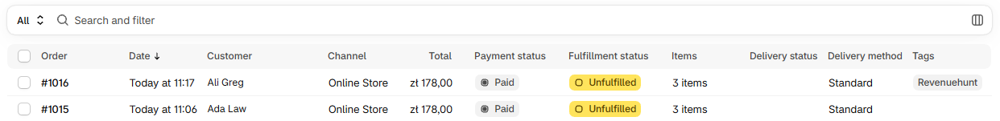

# How to Tag Quiz Orders

This article explains how the RevenueHunt app attributes orders and revenue to your quiz. It also explains how to tag the orders that came from the quiz, so you can find, filter and export them. What is possible depends on your platform.

## What the app does on its own

=== "Shopify"

    The app never changes your orders. It saves quiz data to the Shopify cart instead, and Shopify copies it to the order at checkout.

    When the customer reaches the results page, or goes to the cart or checkout after the quiz, the app saves two hidden cart attributes:

    - `__quiz_response_id`: the ID of the quiz response
    - `__quiz_id`: the ID of the quiz

    In Shopify, the attributes show under `Additional details`, in the `Notes` card of the order.

    

    The app reads these attributes to count quiz orders and revenue in [Analytics](/how-to-guides/track-quiz-revenue/). You do not need to set anything up.

    The quiz answers are not saved to the order on their own. To save answers or other values, add custom JavaScript. See [How to Show Quiz Answers in Shopify Orders](/how-to-guides/show-quiz-answers-in-orders/).

    !!! warning "Attribution needs an unbroken flow"

        The customer has to add products to the cart from the results page, then complete the checkout in the same session. Set the Checkout settings on your results page to `proceed to cart`. See [how to change checkout settings on your results page](/how-to-guides/change-checkout-settings/).

    !!! info "The app does not add Shopify order tags"

        Cart attributes are not order tags. You cannot filter the Shopify Orders list by them. To add a real order tag, use the Shopify Flow workflow in [Tag quiz orders](#tag-quiz-orders).

    !!! tip "The Quiz Completed trigger in Shopify Flow"

        The app also sends a `Quiz Completed` trigger to Shopify Flow, with the answers, customer tags and recommended products. It runs on the customer, before any order exists, so it cannot tag an order. Use it for customer automations instead. See [Automate Quiz Completions with Shopify Flow](/how-to-guides/automate-quiz-completions-with-shopify-flow/).

=== "Shopify (Legacy)"

    The app never changes your orders. It saves quiz data to the Shopify cart instead, and Shopify copies it to the order at checkout.

    This happens only when `Shopify Orders Tagging` is connected for the quiz. It is a setting per quiz, in the `Connect` tab. Your theme must also have Order Notes enabled. See [How to Show Quiz Answers in Shopify Orders](/how-to-guides/show-quiz-answers-in-orders/).

    When the customer completes the quiz, the app saves these cart attributes:

    - `__prq_response_id`: the ID of the quiz response
    - `__prq_quiz_id`: the ID of the quiz
    - one attribute for each answered question, with the answers the customer chose

    The name of a question attribute starts with `__prq_`, then a number and the first words of the question title. A long title is cut short.

    !!! example "A question attribute"

        For a question whose title starts with "How does your", the attribute is `__prq_4_how_does_your_`. Its value is the answer, for example `It feels dry and flakey, sometimes irritated`.

    Every answer is saved, with no custom code. In Shopify, the attributes show under `Additional details`, in the `Notes` card of the order.

    

    If you connect the `Shopify Revenue Report`, the app reads `__prq_response_id` to count quiz orders and revenue. See [How to Track Quiz Revenue](/how-to-guides/track-quiz-revenue/).

    !!! warning "Attribution needs an unbroken flow"

        The customer has to add products to the cart from the results page, then complete the checkout in the same session. Set the Checkout settings on your Results Page to `proceed to cart`. See [how to change checkout settings on your results page](/how-to-guides/change-checkout-settings/).

    !!! info "Shopify Orders Tagging does not add Shopify order tags"

        Despite its name, the setting saves cart attributes, not order tags. You cannot filter the Shopify Orders list by them. To add a real order tag, use the Shopify Flow workflow in [Tag quiz orders](#tag-quiz-orders).

=== "WooCommerce"

    The app does not save any quiz data to WooCommerce orders. It adds no order notes, order meta or tags. The app cannot tell which orders came from the quiz.

    For other ways to link orders to the quiz, see [Tag quiz orders](#tag-quiz-orders).

=== "Magento"

    The app does not save any quiz data to Magento orders. It adds no order comments, attributes or tags. The app cannot tell which orders came from the quiz.

    For other ways to link orders to the quiz, see [Tag quiz orders](#tag-quiz-orders).

=== "BigCommerce"

    The app does not save any quiz data to BigCommerce orders. It adds no staff notes, custom fields or tags. The app cannot tell which orders came from the quiz.

    For other ways to link orders to the quiz, see [Tag quiz orders](#tag-quiz-orders).

=== "Standalone"

    A standalone quiz is not connected to a store, so the app never sees your orders. It cannot save quiz data to them or tell which orders came from the quiz.

    For other ways to link orders to the quiz, see [Tag quiz orders](#tag-quiz-orders).

## Tag quiz orders

=== "Shopify"

    A Shopify Flow workflow can add an order tag to every quiz order. It looks for the `__quiz_response_id` cart attribute the app already saves. No code is needed.

    1. **In Shopify admin, go to `Apps > Flow`.** If your store does not have [Shopify Flow](https://apps.shopify.com/flow), install it. It is free.

    2. **Click `Create workflow`.**

    3. **Click `Select a trigger` and choose `Order created`.** This is a Shopify trigger, not a RevenueHunt trigger.

    4. **Under the trigger, add a `Condition`.**

    5. **Click `Add criteria` and choose the order's custom attributes `Key`.** Flow shows `At least one of order / custom attributes`, and the field `customAttributes_item.key`.

        !!! warning "Choose the custom attributes key"

            Other order properties also have a `key` field. The condition works only on `customAttributes_item.key`.

    6. **Set the operator to `Equal to`, and type `__quiz_response_id` in the value field.**

        

    7. **On the `True` branch, add the action `Add order tags`.**

    8. **Type the tag you want, for example `RevenueHunt Quiz`.**

        

    9. **Give the workflow a name, then click `Turn on workflow`.**

    10. **Open the live quiz on your storefront in an incognito window, and complete it.** Do not test on the preview.

    11. **Add the products to the cart from the results page, then place a [Shopify test order](https://help.shopify.com/en/manual/checkout-settings/test-orders).**

    12. **Open the Shopify Orders list and check the `Tags` column of the test order.**

        

    If the tag is missing, open the test order and look for `__quiz_response_id` under `Additional details`. If it is not there, the order has no quiz data. Check the warning about an unbroken flow above. If it is there, open the workflow in Shopify Flow and review its recent runs.

    !!! note "Only new orders are tagged"

        The workflow tags orders created after you turn it on. Orders placed before that do not get the tag.

    !!! tip "Match orders by hand with CSV files"

        You can also match orders without Shopify Flow. Download your quiz responses as a CSV file. See [How to Download Quiz Responses](/how-to-guides/download-quiz-responses/). Export your orders from `Orders > Export` in Shopify admin. Then match the two files by email address, for example in Google Sheets or Excel. This is a lot of manual work, so it suits an occasional check, not daily use.

=== "Shopify (Legacy)"

    A Shopify Flow workflow can add an order tag to every quiz order. It looks for the `__prq_response_id` cart attribute the app saves when `Shopify Orders Tagging` is connected.

    1. **Connect the quiz to `Shopify Orders Tagging`, and enable Order Notes in your theme.** Follow [How to Show Quiz Answers in Shopify Orders](/how-to-guides/show-quiz-answers-in-orders/).

    2. **In Shopify admin, go to `Apps > Flow`.** If your store does not have [Shopify Flow](https://apps.shopify.com/flow), install it. It is free.

    3. **Click `Create workflow`.**

    4. **Click `Select a trigger` and choose `Order created`.** This is a Shopify trigger, not a RevenueHunt trigger.

    5. **Under the trigger, add a `Condition`.**

    6. **Click `Add criteria` and choose the order's custom attributes `Key`.** Flow shows `At least one of order / custom attributes`, and the field `customAttributes_item.key`.

        !!! warning "Choose the custom attributes key"

            Other order properties also have a `key` field. The condition works only on `customAttributes_item.key`.

    7. **Set the operator to `Equal to`, and type `__prq_response_id` in the value field.**

        

    8. **On the `True` branch, add the action `Add order tags`.**

    9. **Type the tag you want, for example `RevenueHunt Quiz`.**

    10. **Give the workflow a name, then click `Turn on workflow`.**

    11. **Open the live quiz on your storefront in an incognito window, and complete it.** Do not test on the preview.

    12. **Add the products to the cart from the results page, then place a [Shopify test order](https://help.shopify.com/en/manual/checkout-settings/test-orders).**

    13. **Open the Shopify Orders list and check the `Tags` column of the test order.**

        

    If the tag is missing, open the test order and look for `__prq_response_id` under `Additional details`, in the `Notes` card. If they do not, see [Testing the connection](/how-to-guides/show-quiz-answers-in-orders/#testing-the-connection). If they do, open the workflow in Shopify Flow and review its recent runs.

    !!! note "Only new orders are tagged"

        The workflow tags orders created after you turn it on. Orders placed before that do not get the tag.

    !!! tip "Match orders by hand with CSV files"

        You can also match orders without Shopify Flow. Download your quiz responses as a CSV file. See [How to Download Quiz Responses](/how-to-guides/download-quiz-responses/). Export your orders from `Orders > Export` in Shopify admin. Then match the two files by email address, for example in Google Sheets or Excel. This is a lot of manual work, so it suits an occasional check, not daily use.

=== "WooCommerce"

    Order tagging is available in the Shopify versions of the app only. On WooCommerce, you can link orders to the quiz in these ways instead:

    - **Track quiz revenue in Google Analytics.** Compare the purchases of customers who started the quiz with everyone else. See [How to Track Quiz Revenue](/how-to-guides/track-quiz-revenue/).
    - **Match orders by email address in another tool.** Send quiz responses to [Klaviyo](/how-to-guides/send-leads-to-klaviyo/), [HubSpot](/how-to-guides/send-leads-to-hubspot/), [Omnisend](/how-to-guides/send-leads-to-omnisend/), [Zapier](/how-to-guides/send-leads-to-zapier/) or a [webhook](/how-to-guides/send-leads-to-webhooks/). If that tool also receives your WooCommerce orders, you can find the customers who took the quiz and then ordered.
    - **Match orders by hand with CSV files.** Download your quiz responses as a CSV file. See [How to Download Quiz Responses](/how-to-guides/download-quiz-responses/). Export your WooCommerce orders with the customer email addresses, for example with an order export plugin. Then match the two files by email address, for example in Google Sheets or Excel. This is a lot of manual work, so it suits an occasional check, not daily use.
    - **Build a custom integration.** A developer can write a WordPress plugin that receives the quiz webhook. It can then add an order note or order meta to the matching WooCommerce order.

    !!! warning "Email matching is less precise"

        These options match the order by email address, not by the cart. An order placed with a different email address is missed. A later order from the same customer can also be matched, even if it did not come from the quiz.

    !!! note "Custom development is your responsibility"

        The RevenueHunt app does not provide a custom integration, and the support team cannot build one for you.

=== "Magento"

    Order tagging is available in the Shopify versions of the app only. On Magento, you can link orders to the quiz in these ways instead:

    - **Track quiz revenue in Google Analytics.** Compare the purchases of customers who started the quiz with everyone else. See [How to Track Quiz Revenue](/how-to-guides/track-quiz-revenue/).
    - **Match orders by email address in another tool.** Send quiz responses to [Klaviyo](/how-to-guides/send-leads-to-klaviyo/), [HubSpot](/how-to-guides/send-leads-to-hubspot/), [Omnisend](/how-to-guides/send-leads-to-omnisend/), [Zapier](/how-to-guides/send-leads-to-zapier/) or a [webhook](/how-to-guides/send-leads-to-webhooks/). If that tool also receives your Magento orders, you can find the customers who took the quiz and then ordered.
    - **Match orders by hand with CSV files.** Download your quiz responses as a CSV file. See [How to Download Quiz Responses](/how-to-guides/download-quiz-responses/). Export your orders from `Sales > Orders` in the Magento admin, with the customer email column. Then match the two files by email address, for example in Google Sheets or Excel. This is a lot of manual work, so it suits an occasional check, not daily use.
    - **Build a custom integration.** A developer can write a Magento module that receives the quiz webhook. It can then add an order comment to the matching Magento order.

    !!! warning "Email matching is less precise"

        These options match the order by email address, not by the cart. An order placed with a different email address is missed. A later order from the same customer can also be matched, even if it did not come from the quiz.

    !!! note "Custom development is your responsibility"

        The RevenueHunt app does not provide a custom integration, and the support team cannot build one for you.

=== "BigCommerce"

    Order tagging is available in the Shopify versions of the app only. On BigCommerce, you can link orders to the quiz in these ways instead:

    - **Track quiz revenue in Google Analytics.** Compare the purchases of customers who started the quiz with everyone else. See [How to Track Quiz Revenue](/how-to-guides/track-quiz-revenue/).
    - **Match orders by email address in another tool.** Send quiz responses to [Klaviyo](/how-to-guides/send-leads-to-klaviyo/), [HubSpot](/how-to-guides/send-leads-to-hubspot/), [Omnisend](/how-to-guides/send-leads-to-omnisend/), [Zapier](/how-to-guides/send-leads-to-zapier/) or a [webhook](/how-to-guides/send-leads-to-webhooks/). If that tool also receives your BigCommerce orders, you can find the customers who took the quiz and then ordered.
    - **Match orders by hand with CSV files.** Download your quiz responses as a CSV file. See [How to Download Quiz Responses](/how-to-guides/download-quiz-responses/). Export your orders from `Orders > Export` in the BigCommerce control panel. Then match the two files by email address, for example in Google Sheets or Excel. This is a lot of manual work, so it suits an occasional check, not daily use.
    - **Build a custom integration.** A developer can write a service that receives the quiz webhook. It can then use the BigCommerce API to add a staff note to the matching order.

    !!! warning "Email matching is less precise"

        These options match the order by email address, not by the cart. An order placed with a different email address is missed. A later order from the same customer can also be matched, even if it did not come from the quiz.

    !!! note "Custom development is your responsibility"

        The RevenueHunt app does not provide a custom integration, and the support team cannot build one for you.

=== "Standalone"

    Order tagging is available in the Shopify versions of the app only. With a standalone quiz, you can link orders to the quiz in these ways instead:

    - **Track quiz revenue in Google Analytics.** If your website sends purchase events to GA4, compare the purchases of customers who started the quiz with everyone else. See [How to Track Quiz Revenue](/how-to-guides/track-quiz-revenue/).
    - **Match orders by email address in another tool.** Send quiz responses to [Klaviyo](/how-to-guides/send-leads-to-klaviyo/), [HubSpot](/how-to-guides/send-leads-to-hubspot/), [Omnisend](/how-to-guides/send-leads-to-omnisend/), [Zapier](/how-to-guides/send-leads-to-zapier/) or a [webhook](/how-to-guides/send-leads-to-webhooks/). If that tool also receives your orders, you can find the customers who took the quiz and then ordered.
    - **Match orders by hand with CSV files.** Download your quiz responses as a CSV file. See [How to Download Quiz Responses](/how-to-guides/download-quiz-responses/). Export your orders from your order system, with the customer email addresses. Then match the two files by email address, for example in Google Sheets or Excel. This is a lot of manual work, so it suits an occasional check, not daily use.
    - **Build a custom integration.** A developer can write a service that receives the quiz webhook. It can then mark the matching order in your own order system.

    !!! warning "Email matching is less precise"

        These options match the order by email address, not by the cart. An order placed with a different email address is missed. A later order from the same customer can also be matched, even if it did not come from the quiz.

    !!! note "Custom development is your responsibility"

        The RevenueHunt app does not provide a custom integration, and the support team cannot build one for you.

---

This article explains how RevenueHunt links orders to your quiz on each platform, and how to tag quiz orders with Shopify Flow.
